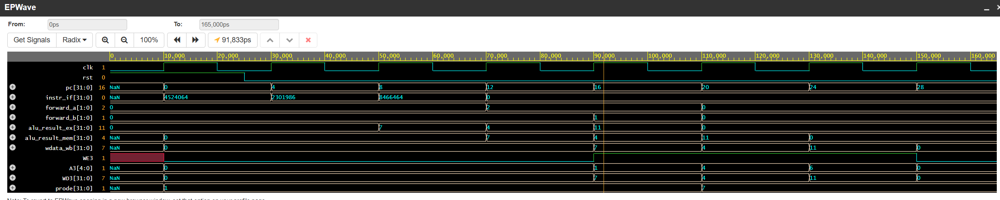

# Simulation & Hazard Verification Report

Functional simulation and timing analysis of the 5-stage pipelined processor core verified in Aldec Riviera-PRO / EDA Playground.

## Waveform Analysis



The waveform demonstrates continuous PC incrementation, active bypass selection on `forward_a` and `forward_b`, and sequential register commits at 110 ns, 130 ns, and 150 ns.

## Test Program & Data Dependencies

The test suite evaluates three back-to-back arithmetic instructions with data dependencies. Registers are initialized upon reset to their respective index (`R[i] = i`):

- **Instr 0:** `ADD R1, R2, R5` $\rightarrow 2 + 5 = 7$ (Target: `R1`)
- **Instr 1:** `SUB R4, R1, R3` $\rightarrow 7 - 3 = 4$ (Target: `R4`, requires `R1` forwarded from Instr 0)
- **Instr 2:** `ADD R6, R4, R1` $\rightarrow 4 + 7 = 11$ (Target: `R6`, requires dual forward of `R4` and `R1`)

## Execution Timeline

Clock period is 20 ns (50 MHz). Reset de-asserts at 25 ns, initiating instruction execution at 30 ns:

- **30 ns – 70 ns (Fetch/Decode):** Instructions enter the pipeline consecutively on every rising edge with zero stall bubbles.
- **70 ns – 90 ns (Instr 0 EX):** `ADD R1, R2, R5` executes, generating ALU result `7`.
- **90 ns – 110 ns (Instr 1 EX):** `forward_a` asserts to `2'b10`, pulling `7` directly from `EX/MEM` into the ALU. `SUB` computes $7 - 3 = 4$.
- **110 ns – 130 ns (Instr 2 EX):** Dual forwarding active. `forward_a = 2'b10` forwards `4` from `EX/MEM`, while `forward_b = 2'b01` forwards `7` from `MEM/WB`. ALU computes $4 + 7 = 11$.
- **110 ns – 150 ns (Writeback):** `WE3` pulses high for three cycles committing values in order: `R1 <= 7` (110 ns), `R4 <= 4` (130 ns), and `R6 <= 11` (150 ns).

## Testbench Output

```text
==================================================
EDA PLAYGROUND VERIFICATION COMPLETE
R[1] = 7 (Expected: 7)
R[4] = 4 (Expected: 4) [Forwarded R1]
R[6] = 11 (Expected: 11) [Forwarded R4 & R1]
==================================================
TEST PASSED: 5-Stage Forwarding Hardware Verified
